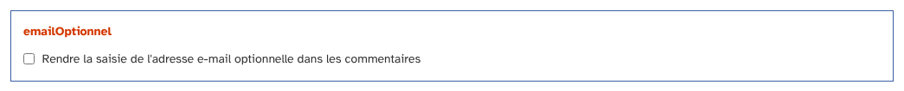
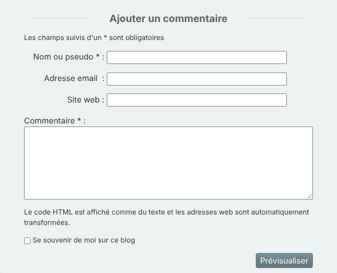

# emailOptionnel : guide d'utilisation

emailOptionnel permet à vos visiteurs de laisser un commentaire sans donner leur adresse e-mail. Normalement, Dotclear exige une adresse valide. Avec ce plugin, le champ devient facultatif.

Ce plugin n'a pas de page d'administration : il s'active par une case à cocher dans les paramètres du blog.

## Sommaire

1. [Activer l'option](#activer-loption)
2. [Ce que voient les visiteurs](#ce-que-voient-les-visiteurs)
3. [Ce qui est enregistré](#ce-qui-est-enregistré)
4. [Désactiver l'option](#désactiver-loption)
5. [Bon à savoir](#bon-à-savoir)

## Activer l'option

1. Allez dans **Blog > Paramètres du blog**.
2. Ouvrez la section **Paramètres des plugins pour ce blog**.
3. Dans le bloc **emailOptionnel**, cochez **Rendre la saisie de l'adresse e-mail optionnelle dans les commentaires**.
4. Enregistrez les paramètres.

Le réglage est propre à chaque blog.

## Ce que voient les visiteurs

Le champ **Adresse email** est toujours présent, mais il n'est plus obligatoire : son astérisque disparaît du libellé. Un visiteur peut le laisser vide, prévisualiser son commentaire puis l'envoyer.

Un visiteur qui renseigne son adresse la voit enregistrée comme d'habitude.

## Ce qui est enregistré

Quand le champ est vide, le commentaire est enregistré avec une adresse vide. Le nom du visiteur et le texte restent obligatoires. L'adresse n'apparaît donc nulle part : ni dans la liste des commentaires de l'administration, ni sur le site.

## Désactiver l'option

Décochez la case dans les paramètres du blog. Le champ redevient obligatoire. Les commentaires déjà publiés sans adresse restent en place.

## Bon à savoir

* **Le champ doit s'appeler `c_mail`** : c'est le cas dans les thèmes de Dotclear. Le plugin retire l'attribut « obligatoire » de ce champ et l'astérisque de son libellé, avec JavaScript. Sans JavaScript, l'astérisque reste affiché, mais le champ vide est quand même accepté.
* **Se souvenir de moi** : la case garde le nom et le site web dans le navigateur du visiteur, comme d'habitude. L'adresse vide n'y change rien.
* **Sans adresse**, tout ce qui s'appuie sur l'e-mail du commentateur (par exemple les avatars Gravatar) n'a rien à utiliser pour ces commentaires.
